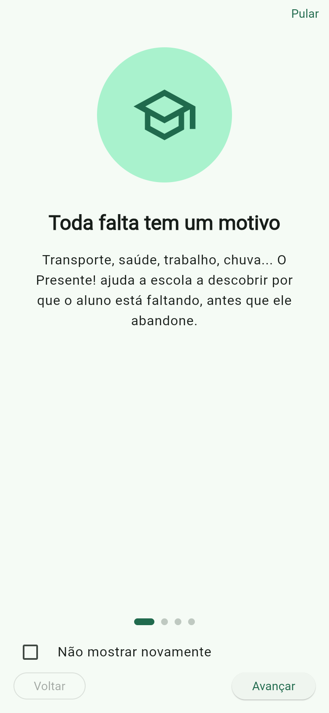
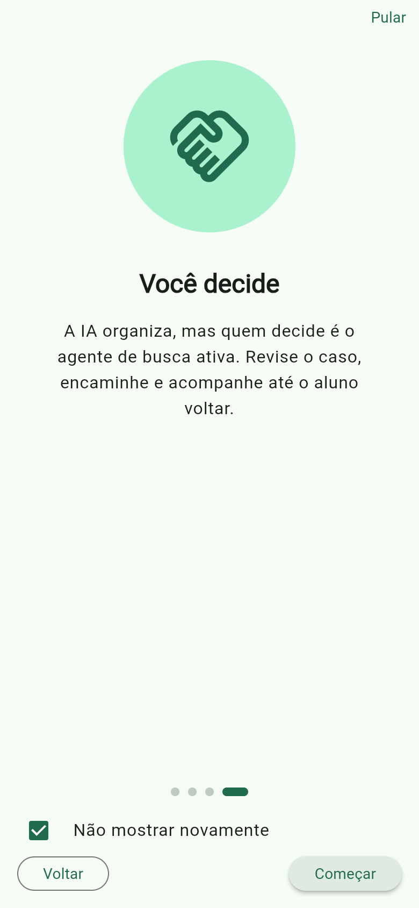
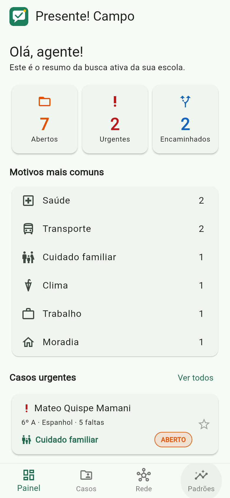
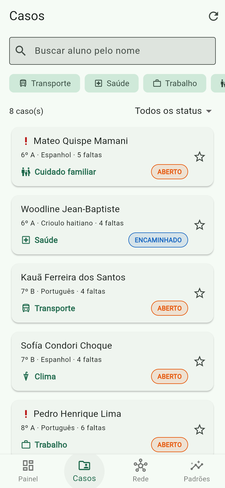
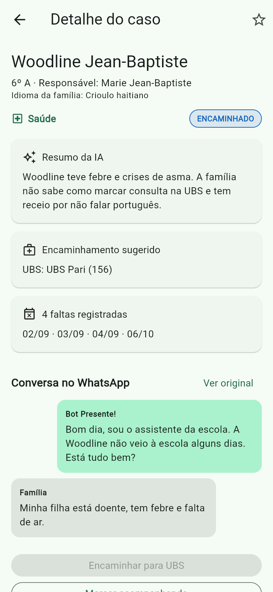
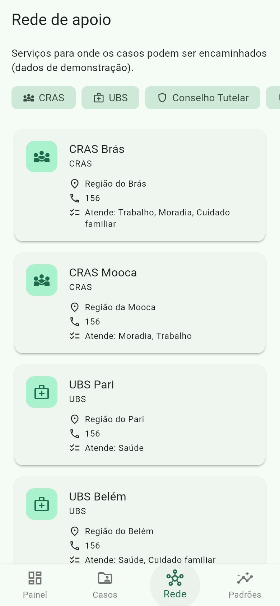
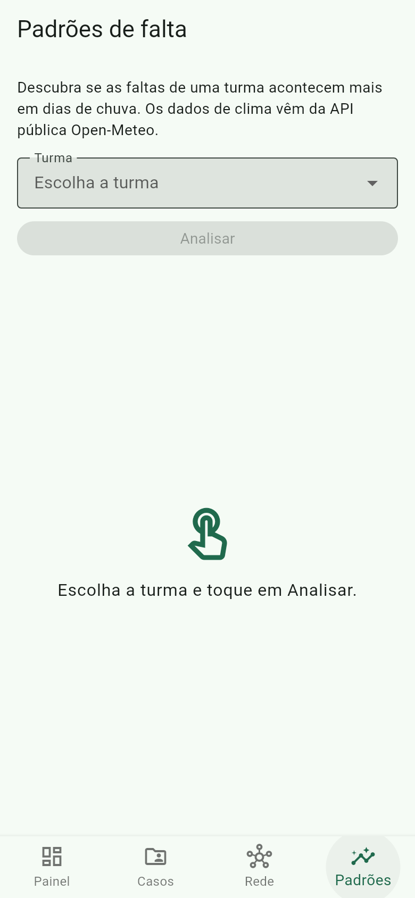
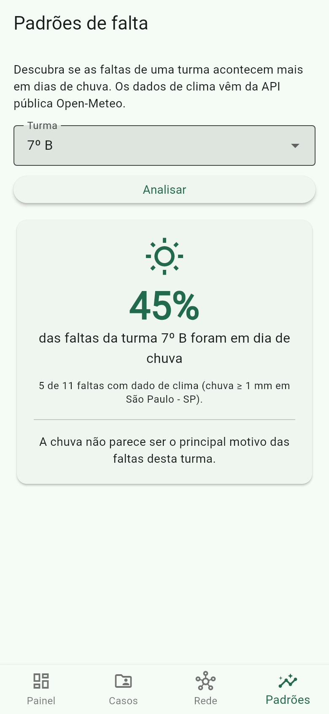

# Presente! Campo

App Flutter do agente de **busca ativa escolar**, parte da solução **Presente!** — Global Solution 2026.2 (FIAP).

## Desenvolvedores

| RM | Nome completo |
|---|---|
| RM555370 | Samuel Okuma |
| RM556678 | Juan Marini |
| RM555918 | Arthur Menon |

## Tema da Global Solution

**Desafio CitizenTech**: identificar um problema real que afete a vida das pessoas e criar uma
solução tecnológica que traga uma melhoria concreta, usando dados, conectividade, sistemas
inteligentes, automação e design para ampliar direitos, facilitar escolhas e reduzir desigualdades.

### ODS relacionados

| ODS | Meta | Como o Presente! contribui |
|---|---|---|
| **ODS 4 – Educação de qualidade** | 4.1 – garantir que todos concluam a educação básica | Principal: descobre o motivo das faltas e age antes da evasão; o app dá ao agente de busca ativa os casos, o encaminhamento e o acompanhamento até o aluno voltar. |
| **ODS 10 – Redução das desigualdades** | 10.2 – incluir jovens em situação de vulnerabilidade | Encaminha as famílias para a rede de proteção (CRAS, UBS, Conselho Tutelar, Passe Livre) e atende famílias imigrantes no idioma delas, com a conversa original e a tradução lado a lado. |

O Presente! combate a **evasão escolar** descobrindo *por que* o aluno está faltando. A família conversa com um bot no WhatsApp, no idioma dela, sem instalar nada. A IA identifica o motivo provável da falta (transporte, saúde, trabalho, cuidado familiar, clima, moradia) e sugere o encaminhamento para a rede de proteção (CRAS, UBS, Conselho Tutelar, Passe Livre).

## Descrição da solução

O **Presente! Campo** é a ferramenta de trabalho de quem faz a busca ativa: coordenador, orientador ou assistente social. Não é um app para as famílias. Com ele o agente:

- vê um **painel** com os casos abertos, urgentes e encaminhados, e os motivos mais comuns;
- **busca e filtra** os casos por nome, motivo e status;
- abre o **detalhe** do caso: resumo da IA, faltas, conversa do WhatsApp (com botão **ver original / ver em português**) e encaminhamento sugerido;
- **encaminha** ou **resolve** o caso (o status e a cor da etiqueta mudam na hora);
- marca casos como **acompanhando** (estrela, salva no aparelho);
- consulta a **rede de apoio** do território;
- descobre **padrões**: cruza as datas de falta de uma turma com a chuva do dia (API Open-Meteo) e mostra "X% das faltas foram em dia de chuva".

## Fluxo de telas

```
Splash ──(onboarding já visto?)──┬── não ──> Onboarding (4 páginas) ──┐
                                 └── sim ───────────────────────────────┤
                                                                        v
                  Principal  [ Painel | Casos | Rede | Padrões ]  (BottomNavigationBar)
                                    │
                         toque no caso (parâmetro: Caso)
                                    v
                             Detalhe do caso ──(volta com o Caso atualizado)──> Principal
```

| Tela | O que faz |
|---|---|
| Splash | Logo (`Image.asset`); lê `onboarding_visto` no SharedPreferences e segue para o Onboarding ou para a Principal |
| Onboarding | 4 páginas (ícone, título, descrição), Voltar/Avançar, "Pular" e checkbox **Não mostrar novamente**; salva a escolha ao concluir |
| Painel | Cards de resumo, motivos mais comuns, casos urgentes |
| Casos | Busca, filtro por motivo (chips) e por status (dropdown), atualizar, estrela de acompanhar |
| Detalhe do caso | Recebe o `Caso` por parâmetro; encaminhar, resolver, acompanhar, alternar idioma da conversa |
| Rede de apoio | Serviços da rede com filtro por tipo |
| Padrões | Estado inicial → Analisar → carregando → resultado ou erro com "Tentar novamente" |

## Prints das telas

| Splash | Onboarding | Onboarding (última página) |
|---|---|---|
|  |  |  |

| Painel | Casos | Detalhe do caso |
|---|---|---|
|  |  |  |

| Rede de apoio | Padrões (estado inicial) | Padrões (resultado da Open-Meteo) |
|---|---|---|
|  |  |  |

## APIs utilizadas

1. **Open-Meteo Historical Weather API** (pública, sem chave) — chuva diária da cidade da escola:
   ```
   GET https://archive-api.open-meteo.com/v1/archive
       ?latitude=-23.55&longitude=-46.63
       &start_date=2026-09-01&end_date=2026-10-26
       &daily=precipitation_sum&timezone=America/Sao_Paulo
   ```
   O JSON (`daily.time` + `daily.precipitation_sum`) vira `List<ClimaDia>` em `ClimaDia.listaFromJson`.

2. **API do MVP Presente!** (FastAPI) — `GET /casos` e `PATCH /casos/{id}`. Configure a URL em
   `lib/data/api_config.dart` (`casosBaseUrl`). Com a URL vazia, o app usa casos de demonstração
   em memória, pela mesma interface `CasoRepository`.

Estados tratados em toda chamada: **inicial**, **carregando**, **sucesso** e **erro** (`ViewState` + componente `EstadoView`), com mensagem amigável e botão **Tentar novamente**.

## Arquitetura

```
lib/
  main.dart               MaterialApp com initialRoute + onGenerateRoute
  app_theme.dart          tema claro/escuro (ColorScheme.fromSeed)
  model/                  classes de dados e enums (Caso.fromJson, ClimaDia, ViewState...)
  data/                   acesso a dados: API (http), repositório local, SharedPreferences
  logic/                  regras de negócio em Dart puro (filtro, status, painel, padrões)
  navigation/             AppRoutes (nomes) e AppNavigation (generateRoute)
  ui/components/          widgets reutilizáveis (CasoCard, EstadoView, StatCard, FiltroChip...)
  ui/screens/             telas
test/                     testes unitários (model, logic, data) e de widget (fluxo do app)
```

- **Separação de responsabilidades:** as telas só desenham e reagem; as regras ficam em `logic/` (testadas), o acesso a dados em `data/` e os modelos em `model/`.
- **Navegação:** rotas nomeadas com `onGenerateRoute`. As telas **não** chamam o `Navigator`: recebem callbacks (`onAbrirCaso`, `onVoltar`...), e a navegação fica toda em `AppNavigation`. O `Caso` vai como argumento para o Detalhe, que devolve o caso atualizado no `pop`.
- **Estado:** `StatefulWidget` + `setState`. A `PrincipalScreen` guarda o estado compartilhado (casos e acompanhados) e repassa às abas por construtor.
- **Persistência local:** `shared_preferences` para `onboarding_visto` e os IDs dos casos acompanhados.

Pacotes: `http`, `equatable`, `shared_preferences`.

## Como rodar

```bash
flutter pub get
flutter run
flutter test      # 53 testes
flutter build apk
```
